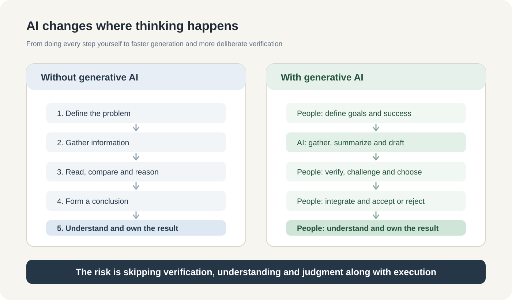

> In one sentence: **The warning sign is not that AI does something for you. It is that, after it has done many things for you, you increasingly no longer know how to do them yourself.**

## Opening: a passing test and a question nobody can answer

At 10:47 p.m., a tester gives an agent a YAML test case and asks it to generate a pytest automation script.

Minutes later, the agent reports that the script has been generated and passes. The terminal is green. Pleased with the improvement in efficiency, the tester shares the result with the team.

The next day, a developer asks an ordinary question:

> “Why does this test prove that a regular user cannot read someone else's order?”

The tester opens the script and studies its assertions. It does call the orders endpoint and assert HTTP 200. But it never checks ownership or constructs a cross-user request. It has tested “the request succeeded” and called that “authorization is correct.”

The agent completed the task, and did so quickly. What was missing was the action a person needed to take: **understanding what the test actually proves.**

This is a synthetic example, not a report of an actual incident. But anyone who uses AI to write code, analyze a problem or organize information may recognize the feeling: the output has been delivered without your really engaging with the work.

That is the subject of this series.

## 1. AI first takes away opportunities to practice thinking

Imagine learning to drive.

If someone always steers, brakes and watches traffic for you, you can reach your destination sooner. But when that driver is unavailable, many hours spent in a car will not have taught you to drive.

There is a similar distinction in AI-assisted work:

- **Completing a task:** obtaining a report, some code or a plan.
- **Developing capability:** understanding the problem, explaining the process, recognizing errors and being able to do similar work independently next time.

These often happen together, but they need not progress at the same rate.

AI makes searching, organizing, drafting, translating and coding inexpensive. The time saved can go into higher-value work, or simply into accepting the next answer faster. The question is where that freed cognitive effort goes.

### A real study: 319 knowledge workers and 936 examples of AI use

Microsoft Research and academic collaborators published a study of generative AI and critical thinking at CHI 2025. They surveyed 319 knowledge workers and analyzed 936 real examples of AI use at work.

The study did not prove that AI reduces intelligence. It observed a more specific change:

- Greater confidence in AI's ability to perform a task was associated with less self-reported critical thinking.
- Greater confidence in one's own professional ability was associated with more active evaluation of AI responses.
- Cognitive work did not simply disappear. It shifted from gathering, writing and executing toward checking information, integrating responses and supervising whether AI had accomplished the actual task.

The researchers call this work *AI stewardship*: the ongoing direction and evaluation of AI output.

The lesson is clear: **faster output does not automatically make judgment more reliable.**

## 2. Four risks that often begin with small habits

### 1. Cognitive offloading: from helping me remember to thinking for me

Cognitive offloading predates AI.

We entrust phone numbers to address books, calculations to calculators and routes to navigation systems. These tools free memory and processing capacity for other purposes. Psychological research has long shown that people adapt their memory and thinking to task demands and available tools.

The problem arises when the boundary keeps moving:

| Activity | Often worth offloading | What to retain |
|---|---|---|
| Memory | Meeting times and where documents are stored | Key principles and the context behind decisions |
| Search | Finding materials and candidate sources | Judging credibility and relevance |
| Writing | Grammar, formatting and initial drafts | The viewpoint, audience and position |
| Programming | Boilerplate and repetitive logic | Defining behavior, checking boundaries and understanding failures |
| Analysis | Summarizing data and suggesting hypotheses | Assessing causality, weighing risks and owning decisions |

Delegating how to search is one thing. Delegating what counts as evidence is another.

### 2. Automation bias: fluent answers invite less verification

The CHI 2025 study includes a lawyer who used ChatGPT to find legal grounds for an argument. The output appeared useful, but still required checking against actual legal sources.

AI can help identify keywords, organize issues and list statutes to investigate. But mistaking fluent language for genuine legal authority turns a small trust error into a potentially serious mistake.

Research on automation bias describes two common problems:

- **Errors of omission:** the system fails to alert the person, who also misses the problem.
- **Errors of commission:** the system gives incorrect advice, which the person follows.

Convenient automated advice can compress the time spent checking it. Busy people doing repetitive work in an unfamiliar field are particularly likely to treat system output as the default answer.

### 3. Fragmented attention: asking about everything without thinking anything through

A common pattern is to ask a question, read the answer, and follow five new lines of inquiry. Each can branch indefinitely. Half an hour later there are ten saved answers, but the original problem remains unresolved.

This replaces an information feed with a conversation feed rather than producing deep research.

Fragmented attention may show up as:

- Turning to AI at the first difficulty.
- Adding more questions before defining the current task.
- Long conversations with little actual judgment or output.
- An inability to tolerate a few minutes without new information.

AI can be a research partner without turning every pause into another round of content consumption.

### 4. Skill decay: automation is comfortable until you must take over

In 2009, Air France Flight 447 experienced unreliable airspeed measurements over the Atlantic. The autopilot disconnected and the aircraft entered a different flight-control mode. The crew needed to fly manually. The accident investigation documented subsequent inappropriate control inputs, inadequate recognition of the stall and failure to take effective recovery action in time.

**The accident cannot be reduced to “autopilot made the pilots forget how to fly.”** The BEA final report identifies interacting factors including unreliable airspeed information, warnings and displays, training and crew coordination.

The useful lesson is that when automation disengages, manual skill, situational understanding and abnormal-event handling must take over immediately. More automation increases the importance of deliberate training, refresher practice and handover mechanisms.

In AI work, routinely reading only an agent's final report without examining traces, assertions or failure causes can leave you unable to start troubleshooting when the agent fails.

## 3. Map the risk: what has AI saved you from doing?

The central change is **a shift from executing work directly toward defining, checking, integrating and taking responsibility**, rather than simply doing less.

Delegating execution can augment capability. Delegating verification and understanding as well removes opportunities to practice it.

## 4. Am I using AI or depending on it?

Hours of daily AI use are not a useful test. Try three questions instead.

**If I turn AI off, do I still know what the problem is?**

If you cannot explain its boundaries, you may have outsourced problem definition from the start.

**Can I identify the most important piece of evidence in the answer?**

Remembering a conclusion without knowing its origin makes its reliability difficult to assess.

**Could I do similar work independently next time?**

If every occurrence requires asking AI again, without reusing your previous understanding, the task may be complete while your capability has not grown.

These are neither psychological tests nor a demand to reject automation. They remind us **not to confuse “AI completed it for me” with “I have mastered it.”**

## Chapter summary

- Cognitive offloading is a normal human strategy. Manage its boundaries rather than banning tools.
- Automation bias can suppress verification. Separate the quality of an explanation from the quality of its evidence.
- More conversations do not necessarily mean deeper thought. Attention needs a defined problem, stopping conditions and uninterrupted time.
- Skills require practice. Preserve the ability to take over and troubleshoot important tasks as automation increases.
- The risk is gradually losing opportunities to understand, judge and correct errors.

> **Next:** These risks concern opportunities to practice attention, thinking, judgment, learning and creativity, rather than an abstract decline in intelligence. Which capabilities should we protect, and how? The next chapter gives concrete exercises.

## References

1. Risko, E. F., & Gilbert, S. J. (2016). [Cognitive Offloading](https://doi.org/10.1016/j.tics.2016.07.002). *Trends in Cognitive Sciences*, 20(9), 676–688.
2. Lee, H.-P., et al. (2025). [The Impact of Generative AI on Critical Thinking](https://doi.org/10.1145/3706598.3713778). *Proceedings of CHI 2025*. A survey of 319 knowledge workers and 936 work examples; the results primarily concern self-reported behavior and perceptions, not a causal experiment on long-term cognitive decline.
3. BEA. (2012). [Final Report on the Accident to the Airbus A330-203, Flight AF 447](https://www.faa.gov/sites/faa.gov/files/AirFrance447_BEA.pdf). The final accident investigation report.
4. Parasuraman, R., & Manzey, D. H. (2010). [Complacency and Bias in Human Use of Automation](https://doi.org/10.1177/0018720810376055). *Human Factors*, 52(3), 381–410.
