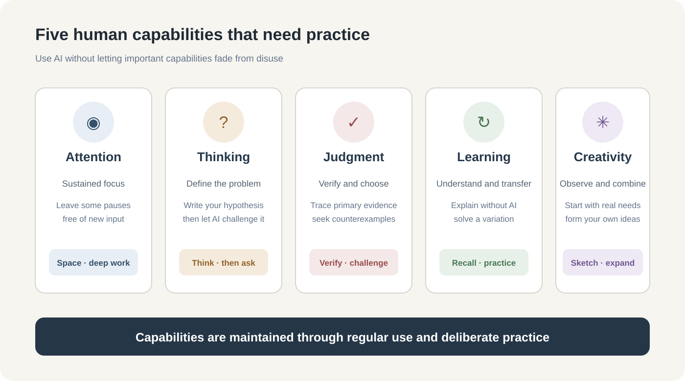

> In one sentence: **The AI era does not require people to compete with machines on speed. It requires people to keep defining problems, judging answers, learning new things and deciding what is worth doing.**

## Opening: AI answered, but did you learn?

You are investigating an intermittently failing automated test. You paste the logs into AI, which suggests that an asynchronous operation may not have finished and recommends waiting longer.

You follow the advice. The test passes.

The next day it fails again. AI suggests increasing the wait from two seconds to five. You comply. The test passes, but the suite is slower and the underlying race condition remains.

If the goal is merely to pass this run, the suggestion appears to have done its job. Developing into an engineer who can solve the problem requires further questions:

- Why does the failure occur intermittently?
- Is the wait too short, or is the problem state synchronization, data isolation or an environmental dependency?
- What experiment would distinguish these hypotheses?

Professional capability develops through questions like these.

**We need not do everything ourselves, but we must preserve the practice that makes us more capable.**

## 1. A map of five capabilities that need practice

These capabilities are not a ranking of ways people outperform AI. They identify parts of AI-assisted work in which you still need to participate.

## 2. Attention: can you think one problem through?

### A small experiment

Open a technical document and plan to read for twenty minutes.

If every unfamiliar word sends you to AI, and every answer leads to another concept, you may learn many terms without understanding the document's main argument.

Try a different sequence:

1. Write the one question those twenty minutes should answer.
2. Read continuously without switching windows.
3. Mark unclear passages without immediately asking about them.
4. Write three points of understanding in your own words.
5. Ask AI the two questions that remain genuine obstacles.

This makes AI a tool you invoke deliberately instead of a continuously interrupting feed.

**Practice:** Set aside one notification-free, twenty-five-minute block each day for a single thinking task. Evaluate the output, not the time spent sitting.

## 3. Thinking: form a hypothesis before asking AI to challenge it

AI is good at organizing a problem into a clear answer. Without trying to decompose the problem yourself, you may not recognize what it has omitted.

Consider the intermittent failure again.

**Avoid starting with:**

> This test fails intermittently. Fix it for me.

That delegates problem definition, causal hypotheses and solution selection together.

**First record your own assessment:**

~~~text
Observation: repeated runs of the same test sometimes pass and sometimes fail.
Known: failures concentrate on the order-status query; rerunning may succeed.
Hypothesis A: the asynchronous status update is delayed.
Hypothesis B: concurrent tests contaminate the test data.
Hypothesis C: an environmental dependency occasionally times out.
Largest uncertainty: what was the server-side order state at the moment of failure?
~~~

Then ask AI to:

- Identify the evidence needed for each hypothesis.
- Propose the smallest experiment that distinguishes them.
- Suggest a fourth cause you might have missed.

AI can then extend your thinking rather than replace it.

**Practice:** For important problems, first write three lines: observation, hypothesis and uncertainty. The wording need not be elegant; its purpose is to preserve your own starting point before seeing AI's answer.

## 4. Judgment: what is justified, and what is not yet justified?

The most tempting wrong AI answer may be **mostly correct with an error at a crucial point**.

For example, retrying a database operation may sound like a way to guarantee eventual success. But if a write is not idempotent, retries can duplicate a charge or create multiple orders.

Judgment means being able to answer:

1. **What is the factual basis?** Can it be traced to official documentation, primary data or actual logs?
2. **Under what conditions is it true?** Which assumptions does it make?
3. **What is a counterexample?** Which input or exceptional condition would invalidate it?
4. **What happens if it is wrong?** A wording correction, or data loss, information exposure or financial damage?

### A simple evidence ladder

~~~text
AI response
   |
   v
Can I identify the original source?
   |-- No --> Treat it as a hypothesis to investigate
   v
Does the source apply to this version and situation?
   |-- No --> Do not apply it directly
   v
Can an experiment, data or counterexample test the claim?
   |-- No --> Explicitly retain the uncertainty
   v
Sufficient evidence --> Include it in the decision
~~~

**Practice:** Trace one important AI claim to primary evidence each day. Open its citation and check whether it supports the conclusion, rather than merely checking that a citation exists.

## 5. Learning: understanding an explanation is not mastery

A clear AI explanation can create an illusion of mastery.

Understanding the explanation and retrieving the idea without it are different abilities.

Retrieval practice is a well-established learning method: close the material and try to recall it. Experiments by Roediger and Karpicke found that testing through retrieval improved delayed retention.

### Make AI a coach instead of an answer service

Suppose you are studying database transaction isolation:

| Stage | Less useful | Better practice |
|---|---|---|
| Initial understanding | Ask AI to explain everything at once | Read first and record what is unclear |
| Check understanding | Stop after reading its explanation | Close the conversation and explain dirty and non-repeatable reads |
| Transfer | Keep viewing more examples | Work through two concurrent transactions yourself |
| Correct mistakes | Request the standard answer immediately | Ask where the reasoning breaks, then repair it yourself |
| Long-term retention | Save the response | Retrieve the concept after a day and again after a week |

You can give AI this instruction:

> Be my learning coach, not an answer generator. Ask one question, wait for my answer and assess what I understand. Do not immediately provide the complete answer. If I am stuck, offer one hint. Finally, have me close the conversation, explain the idea independently and solve a variation.

**Practice:** After learning an important concept, turn AI off and spend three minutes drawing or explaining it. Repeat the next day. Knowledge you can retrieve yourself is more likely to become your own capability.

## 6. Creativity: do not let the first answer set the limits

Ask AI for ten innovative product ideas before observing users, and you will often get ten plausible, familiar ideas.

They need not be bad. The problem is entering AI's option space before looking at reality yourself.

Try this order:

1. Observe a real setting. Where do users stop? Which processes do they work around?
2. Record three observations without immediately turning them into solutions.
3. Draw a rough sketch yourself.
4. Ask AI for cross-domain analogies, objections and alternative approaches.
5. Return to users or real data to test which ideas matter.

AI can widen the search space. It cannot decide which problems deserve your effort or replace your observations of the world.

**Practice:** Make a first version independently, then ask AI to expand the possibilities. Compare what new perspectives it contributes with the real details it does not know.

## 7. Agency: retain control of the direction

Attention, thinking, judgment, learning and creativity support something more fundamental: agency.

AI can list career options, but cannot decide what kind of life you want. It can assess technical approaches, but someone responsible must decide whether a risk is worth taking.

| Area | AI can help with | What people retain |
|---|---|---|
| Goals | Clarification and milestones | What is worth pursuing |
| Options | Generating alternatives and analyzing effects | The trade-off decision |
| Evidence | Collection and synthesis | Verification of important facts |
| Execution | Tasks within an authorized scope | Permissions and stopping conditions |
| Outcomes | Records and risk reminders | Accountability |

Low-risk, reversible, easily checked tasks are good candidates for automation. Higher-risk, irreversible decisions involving values call for greater human participation.

## 8. A weekly practice card

Avoid building another elaborate self-discipline system. Do these five small things each week:

| Capability | One weekly exercise | Evidence to retain |
|---|---|---|
| Attention | Twenty-five minutes without switching windows | Completed reading or analysis |
| Thinking | Write your own hypotheses first | A problem sketch |
| Judgment | Check one important AI conclusion | A primary source or experimental result |
| Learning | Explain a concept with AI turned off | An independent explanation |
| Creativity | Sketch a solution before asking AI | Your first sketch |

No score is necessary. Ask whether you genuinely used these capabilities during the week.

## Chapter summary

- **Attention:** Give important problems uninterrupted time; do not substitute conversation feeds for deep processing.
- **Thinking:** Record your own questions and hypotheses before inviting AI to challenge them.
- **Judgment:** Trace evidence, check assumptions and look for counterexamples.
- **Learning:** Practice independent retrieval, explanation and variations with AI turned off.
- **Creativity:** Observe the world and make a sketch before asking AI to expand the possibilities.
- **Agency:** Do not outsource goals, value judgments or final accountability by default.

> **Next:** Knowing what to protect is only a start. How do you decide when to think first, delegate or stop to verify? The next chapter works through a complete example.

## References

1. Roediger, H. L., & Karpicke, J. D. (2006). [Test-Enhanced Learning: Taking Memory Tests Improves Long-Term Retention](https://doi.org/10.1111/j.1467-9280.2006.01693.x). *Psychological Science*, 17(3), 249–255.
2. Carpenter, S. K., et al. (2022). [The Science of Effective Learning with Spacing and Retrieval Practice](https://doi.org/10.1111/bjep.12475). *British Journal of Educational Psychology*.
3. Parasuraman, R., & Manzey, D. H. (2010). [Complacency and Bias in Human Use of Automation](https://doi.org/10.1177/0018720810376055). *Human Factors*, 52(3), 381–410.
