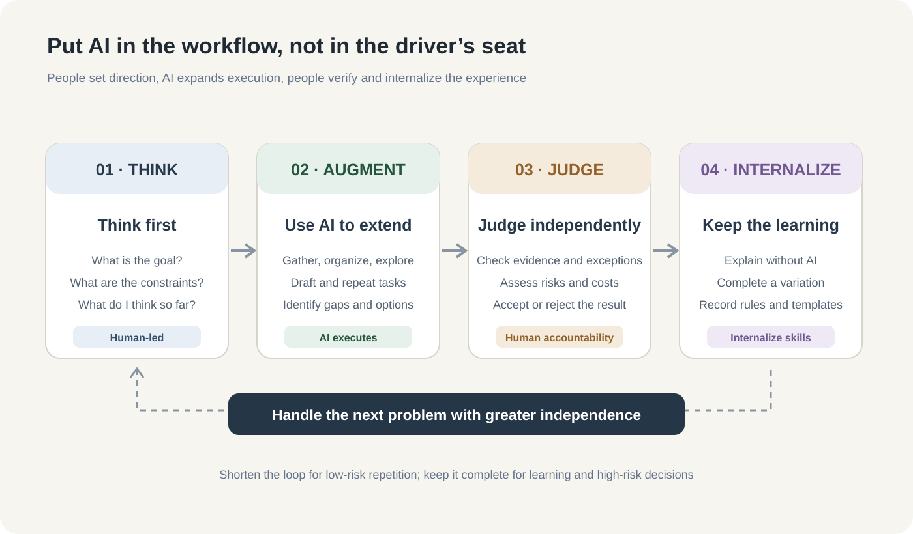

> In one sentence: **Let AI accelerate the work while you remain responsible for understanding it.** Independent thinking means retaining the goal, evidence and reasons for accepting a result in each collaboration.

The first two chapters covered risks and capabilities. Here we work through a concrete task: **asking an agent to generate pytest tests from a YAML description.**

## 1. The complete workflow

These steps do not require manual intervention in every small task. Simple, low-risk, easily verified work can use a shorter process. For learning, professional judgment or substantial risk, preserve problem definition and verification.

## 2. Case: generating an order-authorization test from YAML

### Task background

Suppose the order-query endpoint is:

~~~http
GET /api/orders/{order_id}
Authorization: Bearer <token>
~~~

The business rules are:

- Users may read only their own orders.
- User A must not read user B's order.
- Unauthorized access returns 404 under the current API contract, so order existence is not disclosed.
- The response must not expose ownership, payment information or other restricted fields.

We want the agent to generate pytest code from a YAML description:

~~~yaml
case_id: order_auth_003
title: A regular user cannot read another user's order
preconditions:
  - create_user: user_a
  - create_user: user_b
  - create_order:
      owner: user_b
steps:
  - request:
      method: GET
      path: /api/orders/{user_b_order_id}
      auth_as: user_a
expected:
  status: 404
  body:
    error: NOT_FOUND
~~~

The task looks clear. Would the following output be enough?

~~~python
def test_user_cannot_read_others_order(client, user_a_token, user_b_order):
    response = client.get(
        f"/api/orders/{user_b_order.id}",
        headers={"Authorization": f"Bearer {user_a_token}"},
    )
    assert response.status_code == 404
~~~

Not yet. We must also ask:

- Does `user_b_order` actually belong to `user_b`?
- Does the request really use `user_a`'s identity?
- Does the response body disclose order data?
- Does the test depend on leftover data in a shared environment?
- Would it fail if the authorization logic were removed?

Work through the four steps.

## 3. Think: define what a correct test must establish

Before generating code, write the business meaning and acceptance criteria.

~~~text
Task: verify that a regular user cannot read another user's order.

Identity relationships:
- user_a: the regular user making the request
- user_b: the actual owner of the target order
- order_b: an order created by user_b

Request:
- Use user_a's token
- GET /api/orders/{order_b.id}

Must verify:
1. HTTP status is 404, following the current API contract.
2. The response error code is NOT_FOUND.
3. No order details or sensitive fields appear in the response.
4. This test creates and cleans up its own data.

Outside this test's scope:
- Administrator access across users
- Order-state transitions
- Authorization of other order endpoints
~~~

The crucial step is turning “users cannot read other users' orders” into verifiable behavior.

**Acceptance means the test detects broken authorization, rather than merely running successfully.**

## 4. Augment: delegate generation and exploration

Now give the agent both the YAML and the acceptance criteria.

Ask it to explain the mapping and find omissions:

~~~text
Generate a pytest automation test from the YAML case.

Requirements:
1. Preserve the business meaning of every original step. Do not silently remove or rewrite it.
2. Map preconditions to isolated fixtures or data-creation steps.
3. Turn every expected result into an explicit assertion.
4. Check identity, resource ownership, status, response body and sensitive fields.
5. Do not hide asynchronous or data-synchronization problems with sleep.
6. After the code, provide a mapping table:
   YAML step / generated code location / assertion / remaining risk.
7. Ask about unclear API contracts instead of inventing them.
~~~

AI can quickly generate boilerplate, fixtures and request wrappers, and suggest additional boundary cases. That is a valuable use of the efficiency gain.

However, **the agent's claim of coverage remains a claim to verify, not an acceptance decision.**

## 5. Judge: decide whether the test is meaningful

Compare the result with the business meaning, rather than reviewing only coding style.

### 1. Check the mapping from requirements to code

| YAML or business requirement | What the code must establish | Common omission |
|---|---|---|
| user_a and user_b | Create two distinct identities | Both fixtures refer to the same user |
| user_b owns the order | Set ownership explicitly | Create an order without checking ownership |
| user_a makes the request | Use A's Authorization token | Accidentally use the owner's token |
| Expected 404 | Assert the status explicitly | Check only that no exception was thrown |
| NOT_FOUND error | Inspect the response body | Check only the HTTP status |
| No order disclosure | Check for sensitive fields | Check the error code but ignore leaked data |

### 2. A more complete example

This is illustrative code; adapt fixture names to the actual project:

~~~python
def test_user_cannot_read_others_order(
    client, user_a, user_b, order_factory
):
    # Arrange: establish ownership and distinct user identities.
    order_b = order_factory(owner=user_b)

    # Act: use A's identity to request B's order.
    response = client.get(
        f"/api/orders/{order_b.id}",
        headers={"Authorization": f"Bearer {user_a.token}"},
    )

    # Assert: verify the contract and data isolation.
    assert response.status_code == 404
    assert response.json()["error"] == "NOT_FOUND"
    assert "order" not in response.json()
    assert str(order_b.id) not in response.text
~~~

Actual error contracts may differ. If an interface permits 403, evaluate it against the agreed product and security contract instead of changing it to 404 merely to pass this example.

### 3. Introduce a counterexample: can the test detect a broken system?

| Deliberately introduced defect | Expected result |
|---|---|
| Remove the order-owner check | The test fails |
| Replace the request token with user_b's | The test fails or exposes a construction error |
| Return 200 with order details | The test fails |
| Include sensitive fields in an error response | The test fails |

A test that still passes after authorization is removed has not established authorization correctness.

This resembles mutation testing: change program behavior deliberately and see whether the tests catch it. It provides stronger quality evidence than a green run alone.

### 4. Then review engineering quality

Once the business meaning is correct, check:

- Fixture isolation and cleanup.
- Dependencies on execution order or shared environmental state.
- Fixed sleeps or unbounded retries.
- Whether failures provide useful diagnostic information.
- Stability across repeated runs.

These checks turn executable tests into tests worth trusting.

## 6. Internalize: keep the reasoning as well as the script

Suppose the generated test passes all checks. Spend three more minutes on the learning.

**Turn AI off and answer:**

1. Why must user_a access user_b's order? What cannot be established with only one user?
2. Why is asserting 404 insufficient? What might the body disclose?
3. Which assertion would fail if the owner check were removed, and why?

Explaining the answers independently means acquiring a transferable authorization-testing pattern as well as a script.

Capture a small template:

~~~text
Four elements of an authorization test:
1. Identity: who is making the request?
2. Resource: who owns it?
3. Contract: should access be allowed, denied or concealed?
4. Disclosure: does an error reveal restricted information?
~~~

Reuse it for files, projects, tenants, invoices and other resource-isolation problems rather than starting every conversation from scratch.

## 7. Scale the effort to the task

| Task | Think | Augment | Judge | Internalize |
|---|---|---|---|---|
| Revise wording | Set audience and tone | Ask AI to rewrite | Read through quickly | Often unnecessary |
| Learn a concept | Record current understanding | Ask for explanations and questions | Check sources and examples | Explain independently |
| Generate automated tests | Define behavior and assertions | Generate the script | Check steps, counterexamples and repeated runs | Capture the testing pattern |
| Change production authorization | Define the threat model and compatibility constraints | Search code and propose approaches | Human review of permissions, rollback and monitoring | Record decisions and risks |

Avoid turning every small task into a ceremony. **The capability that matters is knowing when delegation is appropriate and when to stop and judge for yourself.**

## 8. Thirty days: change one habit

| Week | Focus | Deliverable |
|---|---|---|
| 1 | Think: record goals, constraints and initial hypotheses first | Three three-line problem sketches |
| 2 | Augment: request evidence, counterexamples and alternatives, not only conclusions | Two AI outputs with counterexamples |
| 3 | Judge: verify important claims against sources or reverse experiments | Two verification records |
| 4 | Internalize: turn AI off, explain the idea and complete a variation | One independent retrospective |

Each week, ask:

> How much of the time AI saved became better judgment, understanding and capability?

No attractive score is necessary. Observe whether you are moving from waiting for answers toward knowing how to use AI to solve problems.

## Chapter summary

- **Think:** Define business goals, constraints and acceptance criteria first.
- **Augment:** Delegate search, boilerplate generation and repetitive execution.
- **Judge:** Review against actual meaning, evidence, counterexamples and risk.
- **Internalize:** Turn AI off, explain the principles and turn one result into reusable capability.
- **The crucial distinction:** A passing script does not prove a meaningful test. A complete answer does not prove mastery.

> **Closing the series:** Protecting yourself in the AI era does not mean rejecting tools or doing everything manually. Delegate repetition, preserve opportunities to practice, and retain judgment and accountability. **Use AI to expand your capabilities without narrowing your thinking.**

## References

1. Lee, H.-P., et al. (2025). [The Impact of Generative AI on Critical Thinking](https://doi.org/10.1145/3706598.3713778). *Proceedings of CHI 2025*.
2. Roediger, H. L., & Karpicke, J. D. (2006). [Test-Enhanced Learning](https://doi.org/10.1111/j.1467-9280.2006.01693.x). *Psychological Science*, 17(3), 249–255.
3. Risko, E. F., & Gilbert, S. J. (2016). [Cognitive Offloading](https://doi.org/10.1016/j.tics.2016.07.002). *Trends in Cognitive Sciences*, 20(9), 676–688.
