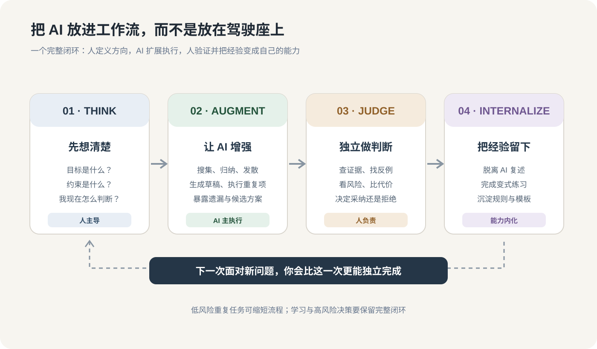

> 一句话点题：**让 AI 负责加速，让自己负责看清楚。** 独立思考不是拒绝 AI，而是在每一次协作里，仍然知道目标是什么、证据在哪里、为什么接受这个结果。

前两篇说了风险和能力。这一篇不再继续讲大道理，我们拿一个具体任务走一遍：**让 Agent 根据 YAML 描述生成 pytest 自动化用例。**

## 一、先看完整工作流

四步不是要求每件事都人工参与。简单、低风险、容易验证的任务可以缩短流程；但只要任务涉及学习、专业判断或较大风险，就不要跳过定义问题和核验结果。

## 二、完整案例：让 Agent 根据 YAML 生成订单鉴权测试

### 任务背景

假设有一个订单查询接口：

~~~http
GET /api/orders/{order_id}
Authorization: Bearer <token>
~~~

业务规则如下：

- 用户只能读取自己名下的订单。
- 用户 A 不能读取用户 B 的订单。
- 无权访问时，接口按当前 API 契约返回 404（避免暴露订单是否存在）。
- 响应体不能泄露订单所有者、支付信息等不应返回的字段。

我们希望 Agent 根据 YAML 用例描述，生成 pytest 自动化脚本。

先看一份简化的 YAML：

~~~yaml
case_id: order_auth_003
title: 普通用户不能读取他人的订单
preconditions:
  - create_user: user_a
  - create_user: user_b
  - create_order:
      owner: user_b
steps:
  - request:
      method: GET
      path: /api/orders/{user_b_order_id}
      auth_as: user_a
expected:
  status: 404
  body:
    error: NOT_FOUND
~~~

看上去任务很清楚。但如果 Agent 只生成下面这段代码：

~~~python
def test_user_cannot_read_others_order(client, user_a_token, user_b_order):
    response = client.get(
        f"/api/orders/{user_b_order.id}",
        headers={"Authorization": f"Bearer {user_a_token}"},
    )
    assert response.status_code == 404
~~~

它是不是就算完成了？

还不够。至少还要问：
- user_b_order 确实属于 user_b 吗？
- 请求真的使用了 user_a 的身份吗？
- 响应体有没有泄露订单数据？
- 测试是否依赖共享环境里残留的数据？
- 如果鉴权逻辑被删掉，这条测试会不会失败？

下面按四步走。

## 三、Think：先定义“什么才算测对了”

先别让 Agent 写代码。先把业务语义和验收标准写出来。

~~~text
任务：验证普通用户不能读取其他用户的订单。

身份关系：
- user_a：发起请求的普通用户
- user_b：目标订单的真实所有者
- order_b：由 user_b 创建的订单

请求：
- 使用 user_a 的 token
- GET /api/orders/{order_b.id}

必须验证：
1. HTTP 状态码为 404（以当前接口契约为准）
2. 响应体错误码为 NOT_FOUND
3. 响应体不包含订单详情或敏感字段
4. 测试数据由本用例独立创建和清理

不在本用例验证：
- 管理员跨用户读取权限
- 订单状态流转
- 其他订单接口的鉴权
~~~

这里最重要的动作，是把“普通用户不能读取别人的订单”拆成了可以验证的行为。

**验收标准不是“脚本能跑”，而是“如果鉴权失效，这条测试一定能发现”。**

## 四、Augment：让 AI 承担生成与探索

现在再把 YAML 和验收标准交给 Agent。

不要只说“帮我生成 pytest”，而要明确要求它解释映射关系，并主动找遗漏：

~~~text
请根据 YAML 用例生成 pytest 自动化测试。

要求：
1. 严格保留原始步骤的业务语义，不得擅自删减或改写。
2. 将前置条件映射为独立 fixture 或数据构造步骤。
3. 每条 expected 都必须落成明确断言。
4. 检查身份、资源归属、状态码、响应体和敏感字段。
5. 不允许用 sleep 掩盖异步或数据同步问题。
6. 输出代码后，附一张映射表：
   YAML 步骤 / 生成代码位置 / 对应断言 / 尚未覆盖的风险。
7. 对不明确的接口契约先提出问题，不要自行猜测。
~~~

AI 可以很快完成样板代码、fixture、请求封装，也可以给出额外的边界测试建议。让它做这些，正是效率提升的价值。

但注意：**AI 给出的“已覆盖”只是一个待核验的主张，不是验收结论。**

## 五、Judge：人来判断测试是否真的有意义

现在进入最关键的一步。不要只读代码风格，要拿业务语义逐项对照。

### 1. 检查 YAML 与代码是否一一对应

| YAML / 业务要求 | 生成代码必须体现 | 常见漏项 |
|---|---|---|
| user_a、user_b | 创建两个不同身份 | 两个 fixture 实际用了同一个用户 |
| 订单归属 user_b | 订单 owner 明确为 user_b | 只创建订单，没验证归属 |
| 请求身份 user_a | Authorization 使用 A 的 token | 错用了订单所有者 token |
| 预期 404 | 明确断言状态码 | 只判断请求没有抛异常 |
| 错误码 NOT_FOUND | 检查响应体 | 只检查 HTTP 状态码 |
| 不泄露订单详情 | 检查响应体不含敏感字段 | 只看错误码，不看数据泄露 |

### 2. 一个更完整的测试示例

下面是示意代码，fixture 名称需要按项目实际实现调整：

~~~python
def test_user_cannot_read_others_order(
    client, user_a, user_b, order_factory
):
    # Arrange：订单归属明确，两个用户身份不同
    order_b = order_factory(owner=user_b)

    # Act：使用 A 的身份访问 B 的订单
    response = client.get(
        f"/api/orders/{order_b.id}",
        headers={"Authorization": f"Bearer {user_a.token}"},
    )

    # Assert：验证契约与数据隔离
    assert response.status_code == 404
    assert response.json()["error"] == "NOT_FOUND"
    assert "order" not in response.json()
    assert str(order_b.id) not in response.text
~~~

这里还要注意：真实项目的错误响应契约可能不同，不能机械复制示例断言。若接口允许返回 403，就应按产品和安全设计约定验收，而不是为了让测试通过擅自改成 404。

### 3. 用反例检查：故意把系统改坏，测试能抓住吗？

这是非常有效、但容易被忽略的一步。

| 人为引入的缺陷 | 预期测试结果 |
|---|---|
| 删除订单 owner 校验 | 测试失败 |
| 把请求 token 换成 user_b | 测试应失败或暴露测试构造问题 |
| 返回 200 和订单详情 | 测试失败 |
| 错误响应中带出敏感字段 | 测试失败 |

如果把鉴权逻辑删掉，测试依然通过，那么这条测试并没有证明鉴权正确。

这类检查与变异测试（Mutation Testing）的思路一致：人为改变程序行为，看测试能不能捕获变化。它比“测试跑绿了”更接近真正的质量验证。

### 4. 最后再看工程质量

业务语义正确后，再检查：
- fixture 是否隔离，测试结束是否清理数据；
- 是否依赖执行顺序或共享环境状态；
- 是否存在固定 sleep、无上限重试；
- 失败信息是否能帮助定位问题；
- 重复执行多次，结果是否稳定。

这一步，才是把“能跑”提升到“可信”。

## 六、Internalize：别只收下脚本，要把判断方法留下来

现在假设 Agent 生成的用例通过了所有检查。工作还可以再多做三分钟：

**关掉 AI，回答三个问题：**

1. 为什么必须让 user_a 访问 user_b 的订单？如果只用一个用户，测试证明不了什么？
2. 为什么只断言 404 不够？响应体还可能泄露什么？
3. 如果把 owner 校验删掉，哪条断言会失败？为什么？

如果你能独立解释，就不只是拿到了一个脚本，还掌握了一个可迁移的鉴权测试模式。

把这次经验沉淀成一个小模板：

~~~text
鉴权测试四要素：
1. 身份：谁在发请求？
2. 资源：资源属于谁？
3. 契约：预期允许、拒绝还是隐藏资源？
4. 泄露：失败响应是否暴露不该暴露的信息？
~~~

下次遇到文件、项目、租户、账单等资源隔离问题，就可以复用这套思路，而不必从零开始问 AI。

## 七、四步法不是仪式：不同任务，投入不同

| 任务类型 | Think | Augment | Judge | Internalize |
|---|---|---|---|---|
| 改一段文案 | 明确受众与语气 | AI 改写 | 快速通读 | 通常可省略 |
| 学一个新概念 | 写出已有理解 | AI 解释与出题 | 检查来源和例子 | 独立复述 |
| 生成自动化用例 | 定义业务语义与断言 | Agent 生成脚本 | 对照步骤、反例、重复执行 | 总结测试模式 |
| 生产鉴权改造 | 明确威胁模型和兼容约束 | AI 搜索代码、列方案 | 人审权限、回滚与监控 | 记录决策与风险 |

不要把每件小事都做成一套复杂流程。**真正的能力，是知道什么时候可以放心交给 AI，什么时候必须停下来自己判断。**

## 八、30 天实践：只改变一个习惯

| 周次 | 练习重点 | 每周交付物 |
|---|---|---|
| 第 1 周 | Think：重要任务先写目标、约束和初步假设 | 3 份三行问题草稿 |
| 第 2 周 | Augment：让 AI 给证据、反例和替代方案，而不只给结论 | 2 份带反例的 AI 产出 |
| 第 3 周 | Judge：挑关键结论做来源核验或反向实验 | 2 份核验记录 |
| 第 4 周 | Internalize：关闭 AI，复述并完成一个变式任务 | 1 份独立复盘 |

每周只问自己一个问题：

> 这周 AI 帮我省下的时间，有多少变成了更好的判断、理解和能力？

不需要追求一个漂亮的分数。你只需要观察自己有没有从“等 AI 给答案”，慢慢变成“知道如何让 AI 帮我解决问题”。

## 本章小结

- **Think**：先定义业务目标、约束和验收标准。
- **Augment**：把搜索、样板生成、重复执行交给 AI。
- **Judge**：对照真实语义、证据、反例和风险审查结果。
- **Internalize**：关闭 AI，解释关键原理，把一次结果变成可复用能力。
- **最重要的分界线**：脚本通过，不代表测试有意义；答案完整，不代表自己已经掌握。

> **系列收束**：AI 时代的自我保护，不是拒绝工具，也不是事事亲力亲为。把重复劳动交给机器，把练习机会留给自己，把关键判断和最终责任握在手中。**让 AI 扩大你的能力半径，而不是缩小你的思考半径。**

## 参考资料

1. Lee, H.-P., et al. (2025). [The Impact of Generative AI on Critical Thinking](https://doi.org/10.1145/3706598.3713778). *Proceedings of CHI 2025*.
2. Roediger, H. L., & Karpicke, J. D. (2006). [Test-Enhanced Learning](https://doi.org/10.1111/j.1467-9280.2006.01693.x). *Psychological Science*, 17(3), 249–255.
3. Risko, E. F., & Gilbert, S. J. (2016). [Cognitive Offloading](https://doi.org/10.1016/j.tics.2016.07.002). *Trends in Cognitive Sciences*, 20(9), 676–688.
